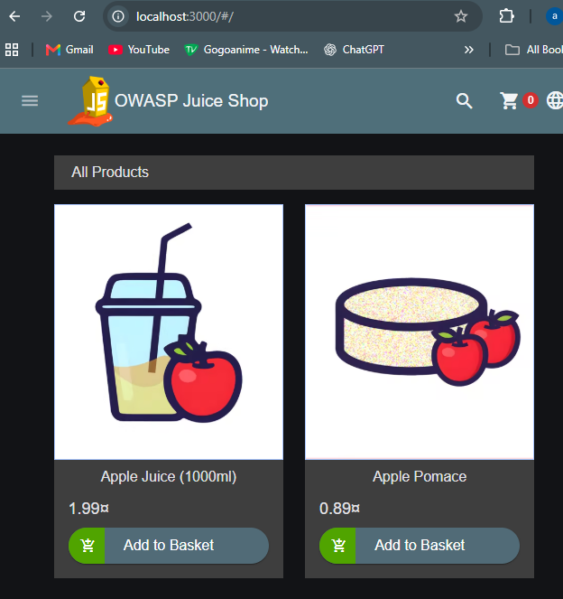
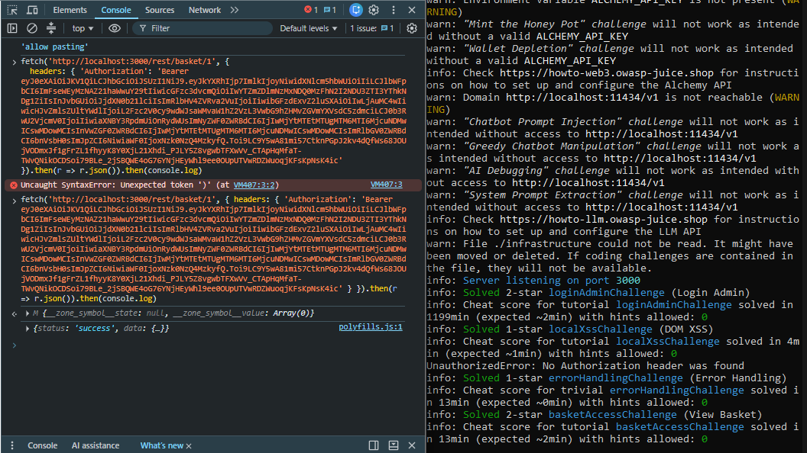
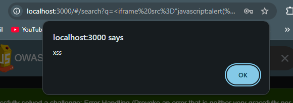
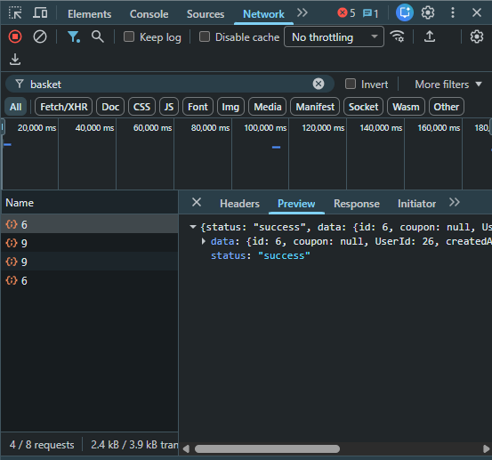

# 🛡️ Lab 4 — Active Web Application Penetration Test

**Name:** NUR ALYA INSYIRAH BINTI KAMARULZAMAN

**Class:** L02-B04

**Course:** IKB21403 Vulnerability Analysis

**Submission Date:** 20 November 2026

---

## 🎯 Target (Victim) Setup

| Item | Detail |
|---|---|
| Application | OWASP Juice Shop |
| Version | v20.4.0 (node22, win32_x64 release build) |
| Deployment | Run locally on the attacker's own machine, not a shared/public instance |
| Command used | Pre-built Windows release, launched with `npm start` from the extracted `juice-shop_20.4.0-SNAPSHOT` folder |
| URL | `http://localhost:3000` |
| Nature of target | Intentionally vulnerable e-commerce web application, built and maintained by OWASP specifically for legal security-testing practice |

> ⚠️ This application is an official OWASP training project. No real users, data, or production systems were involved. All testing was performed against a locally-hosted, self-controlled instance.

**Evidence:** 

The application running locally and reachable in the browser.

---

## 💻 Attacker (Own Host) Setup

| Item | Detail |
|---|---|
| OS | Windows (laptop) |
| Interface | Command Prompt (`cmd`) |
| Runtime | Node.js (bundled with the Juice Shop Windows release) |
| Browser / tooling | Google Chrome — DevTools (Network, Console, Application tabs) used for request inspection, token extraction, and sending authenticated requests |
| Network | Local only — all traffic stayed on `localhost`, no external network exposure |

---

## 🔍 Findings

### 1. SQL Injection — Authentication Bypass
**Severity:** High

**Endpoint:** `POST /rest/user/login`

**Payload:**
- Email: `' OR 1=1--`
- Password: `x` (any value)

**Description:**
The login form concatenates user input directly into a SQL query server-side. The payload `' OR 1=1--` closes the string early, injects a condition that is always true, and comments out the rest of the query (including the password check) — causing the backend to authenticate as the first matching user record without a valid password.

**Evidence:**

Server log confirms `Solved 2-star loginAdminChallenge (Login Admin)`, verifying the bypass was successfully triggered.
- `evidence/requests/01-sqli-login.txt` — exact payload and request detail.

---

### 2. Cross-Site Scripting (XSS) — Reflected
**Severity:** Medium–High

**Endpoint:** Search bar → `GET /#/search?q=...`

**Payload:**
```html
<iframe src="javascript:alert(`xss`)">
```

**Description:**
The search term is reflected into the page DOM without output encoding, allowing injected HTML/JavaScript to execute in the browser. In this test, the payload triggered an immediate JavaScript `alert()` box, confirming arbitrary script execution in the victim's session context.

**Evidence:**

Triggered alert box.
- `evidence/requests/02-xss.txt` — exact payload and URL used.

---

### 3. Broken Access Control — Insecure Direct Object Reference (IDOR)
**Severity:** High

**Endpoint:** `GET /rest/basket/{id}`

**Method:** Authenticated as UserId 26 (own basket ID = 6), then requested `basket/1` — a basket belonging to a different user — using own valid JWT.

**Description:**
The endpoint does not verify that the requesting user owns the basket ID being queried. Using a valid session token for basket ID 6, a request for basket ID 1 was accepted by the server (`{status: 'success', data: {}}`) instead of being rejected, confirming the application trusts the client-supplied ID rather than checking ownership server-side.

**Evidence:**

DevTools Network tab showing the authenticated user's own basket request (`basket/6`, `UserId: 26`).

console output of the cross-basket request plus server log confirming `Solved basketAccessChallenge (View Basket)`.
- `evidence/requests/03-idor.txt` — exact `fetch()` request used, plus a note on why direct address-bar access returns 401 (no Authorization header on a plain GET — a transport detail, not proof the control is working).

---

## 📊 Analysis & Interpretation

Individually, each finding is serious; combined, they compound. Proof of exploitability for all three was captured directly from the application's own internal challenge-tracking log (`Solved loginAdminChallenge`, `Solved basketAccessChallenge`), not just inferred from behavior — meaning these are confirmed, intended vulnerabilities rather than false positives.

An attacker who can bypass authentication via SQL injection does not even need the IDOR to access other accounts — they can log in as any user directly. But the IDOR shows the authorization layer is *independently* broken: even a legitimately authenticated, non-privileged user can access other users' data without ever touching authentication at all. The XSS vulnerability adds a third independent attack path — one that doesn't require any backend trust at all, only a victim clicking a crafted link — making session hijacking or credential theft possible via a shared URL.

| Vulnerability | OWASP Top 10 Category | Risk | Suggested Fix |
|---|---|---|---|
| SQL Injection | A03: Injection | High | Use parameterized queries / prepared statements; never concatenate user input into SQL |
| Reflected XSS | A03: Injection | Medium–High | Encode output rendered into the DOM; enforce a strict Content-Security-Policy |
| IDOR (basket access) | A01: Broken Access Control | High | Verify server-side that the authenticated user owns the requested object ID before returning data |

---

## 🚧 Limitations

- Testing was performed against a local instance only; findings reflect this specific version (v20.4.0) and may not apply identically to other deployments or versions.
- Direct browser address-bar requests to `/rest/basket/{id}` returned 401 because the app uses Bearer-token auth rather than cookies — this was a transport-layer limitation of that specific test method, not a sign the access control was working, and was worked around using an authenticated `fetch()` call from the DevTools console instead.
- Testing focused on three vulnerability classes (SQLi, XSS, IDOR) within the time available; the full OWASP Top 10 was not exhaustively tested against this target.
- No automated scanning tool (e.g. OWASP ZAP active scan) was run to completion; findings were identified and confirmed manually.

---

## 📁 Repository Structure

```
.
├── README.md
└── evidence/
    ├── 00-target-running.png
    ├── 02-xss.png
    ├── 03-idor-network-tab.png
    ├── 03-idor-and-sqli-solved-log.png
    └── requests/
        ├── 01-sqli-login.txt
        ├── 02-xss.txt
        └── 03-idor.txt
```

---

## ⚖️ Ethical Note

All testing in this report was conducted against OWASP Juice Shop, an application explicitly designed and distributed by OWASP for security training purposes, running locally on the tester's own machine. No unauthorized systems, real user data, or production environments were accessed at any point.
